<picture>
  <source media="(prefers-color-scheme: dark)" srcset="./assets/header-dark.svg">
  <source media="(prefers-color-scheme: light)" srcset="./assets/header-light.svg">
  
</picture>

 

I'm a full stack developer from the Philippines. Most recently I helped build web apps and backend services at **EBOS Cloud Accountants**, turning complicated workflows into products people actually enjoy using.

Most days I move between Laravel, React, Vue, and FastAPI, with PostgreSQL underneath and a growing pile of AI tooling on the side.

 

### Selected work

| | |
| :-- | :-- |
| **[NestSeeker](https://github.com/FrancisCodex/NestSeeker)** &nbsp;·&nbsp; [live ↗](https://nestseeker.vercel.app) | A decision-support platform helping renters compare properties with more confidence. |
| **[OnTheJob Tracker](https://github.com/FrancisCodex/OJT-Tracker)** &nbsp;·&nbsp; [live ↗](https://onthejob-tracker.vercel.app) | One workspace for students, coordinators, and training agencies to manage OJT progress. |
| **[Cosmos Coffee](https://github.com/FrancisCodex/Cosmos_ServerSide)** | A coffee ordering concept built around secure transactions and a calm storefront. |

 

### Stack

<picture>
  <source media="(prefers-color-scheme: dark)" srcset="https://skillicons.dev/icons?i=ts,php,python,laravel,react,nextjs,vue,angular,nodejs,fastapi,postgres,supabase,docker&theme=dark&perline=13">
  <source media="(prefers-color-scheme: light)" srcset="https://skillicons.dev/icons?i=ts,php,python,laravel,react,nextjs,vue,angular,nodejs,fastapi,postgres,supabase,docker&theme=light&perline=13">
  
</picture>

 

### On repeat

  

  <a href="https://franciscodex.github.io">Portfolio</a> &nbsp;·&nbsp;
  <a href="https://www.linkedin.com/in/francisaltesing/">LinkedIn</a> &nbsp;·&nbsp;
  <a href="mailto:francisadrian.altesing@gmail.com">francisadrian.altesing@gmail.com</a>

